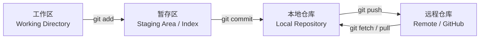

# Git 术语库（Git Glossary）

> 适用环境：Git 2.55.0 · Windows · GitHub
> 标注 **【今日实例】** 的例句均来自本仓库（git-learning）2026-11-14 的真实操作输出。
> 危险等级：🟢 安全可反复用 · 🟡 谨慎（影响历史/暂存区） · 🔴 危险（可能丢数据，先备份）

---

## 0. 一图看懂：代码的四个家



每一次改动从左到右「搬家」，`git status` 报告它现在住在哪。

---

## 1. 仓库与核心对象

| 术语 | 中文 | 一句话解释 |
|---|---|---|
| Repository (repo) | 仓库 | 一个被 Git 管理的项目目录，全部历史都在其中的 `.git` 子目录里 |
| `.git` 目录 | — | 仓库的心脏：数据库、配置、分支引用全在此；删掉它 = 丢掉全部历史 |
| Working Directory / Working Tree | 工作区 | 你眼睛看得见、编辑器改得了的目录，即「现在这份文件」 |
| Staging Area / Index | 暂存区（索引） | 下一次提交的「购物车」；`git add` 就是把改动放进货车的动作 |
| HEAD | 头指针 | 当前所在位置的指针，通常指向「当前分支的最新提交」 |
| detached HEAD | 游离头指针 | HEAD 直接指到某个提交而不是分支上，此时的新提交容易丢失；`git switch -` 可逃离 |
| Commit | 提交 | 一次带作者、邮箱、时间、说明的快照，不可变的存档点 |
| Snapshot | 快照 | Git 存的是每个时刻的完整文件树（而非逐条差异），这是它快的根源 |
| SHA / hash | 哈希值 | 每个提交的唯一身份证，40 位十六进制，日常只用前 7 位（如 `74e697b`）**【今日实例】** |
| Branch | 分支 | 指向某提交的可移动指针；建分支几乎零成本（只是加一个 41 字节的文件） |
| Tag | 标签 | 钉死在某个提交上的书签；annotated tag（附注标签）带信息可签名，lightweight tag 只是个指针 |
| Ref | 引用 | 分支、标签、HEAD 的统称，「指向提交的指针」 |
| Reflog | 引用日志 | 记录 HEAD 每次移动的私人黑匣子（默认存 90 天），误删分支后的救命稻草 |

---

## 2. 文件的四种状态

| 术语 | 中文 | 含义 | 对应 status 显示 |
|---|---|---|---|
| Untracked | 未跟踪 | 新文件，Git 还没开始管它 | 红色 `??` **【今日实例：`?? .workbuddy/`】** |
| Staged | 已暂存 | 已 `git add`，等着进下一次提交 | 绿色 `A` / `M` |
| Modified | 已修改 | 被跟踪的文件改了但还没 add | 红色 `M` |
| Clean | 干净 | 三区完全一致，无事可做 | `## main...origin/main` 无附加行 **【今日实例】** |
| Dirty | 脏 | 有未提交的改动 | — |

---

## 3. 高频操作动词

| 术语 | 危险等级 | 一句话解释 | 常用形态 |
|---|---|---|---|
| `init` | 🟢 | 把当前目录变成仓库（生成 `.git`） | `git init` |
| `clone` | 🟢 | 把远程仓库整个下载成本地仓库 | `git clone <url>` |
| `add` / stage | 🟢 | 把工作区改动放入暂存区 | `git add README.md` / `git add .` **【今日实例】** |
| `commit` | 🟢 | 把暂存区打包成一个永久快照 | `git commit -m "说明"` **【今日实例】** |
| `status` | 🟢 | 查看三区差异概览 | `git status --short --branch` **【今日实例】** |
| `diff` | 🟢 | 逐行看改了什么 | `git diff`（工作区）/ `git diff --staged`（暂存区） |
| `log` | 🟢 | 看提交历史 | `git log --oneline --decorate` **【今日实例】** |
| `push` | 🟡 | 把本地提交上传到远程 | `git push`（已设跟踪时）/ `git push -u origin main` 首次 **【今日实例】** |
| `fetch` | 🟢 | 只下载远程新提交、**不**合并进来 | `git fetch origin` |
| `pull` | 🟡 | = `fetch` + `merge`，下载并合并 | `git pull` |

---

## 4. 分支与合并

| 术语 | 危险等级 | 一句话解释 |
|---|---|---|
| `branch` | 🟢 | 建（`git branch <名>`）/ 列（`git branch`）/ 删（`git branch -d <名>`）分支 |
| `branch -M` | 🟡 | 强制重命名当前分支 **【今日实例：`master` → `main`】** |
| `switch` / `checkout` | 🟢 | 切换分支（新命令用 `switch`；老命令 `checkout` 兼职太多，官方已拆分） |
| `restore` | 🟡 | 丢弃工作区改动，恢复到暂存区/某提交的版本（旧 `checkout -- <file>`） |
| `merge` | 🟡 | 把另一个分支的提交并进当前分支 |
| Fast-forward | 🟢 | 快进合并：目标分支没有新提交，指针直接前移，不产生合并提交 |
| Merge conflict | 🟡 | 合并冲突：两边改了同一处，Git 停下等人裁决 |
| Conflict markers | — | 冲突标记 `<<<<<<<`（我方）/ `=======`（分界）/ `>>>>>>>`（对方） |
| `rebase` | 🔴 | 变基：把整串提交摘下来嫁接到新基底，**会改写历史**，公用分支禁用 |
| `cherry-pick` | 🔴 | 摘樱桃：只把某一个提交复制到当前分支 |
| Squash | 🟡 | 压缩合并：多个提交揉成一个（PR 合并时的 "Squash and merge"） |

---

## 5. 撤销与改写历史（危险区，先看等级再动手）

| 术语 | 危险等级 | 一句话解释 |
|---|---|---|
| `commit --amend` | 🟡 | 修补最近一次提交（改信息/补文件）；**已推送的提交不要 amend** |
| `reset --soft` | 🟡 | 只移动 HEAD：提交消失但改动留在暂存区 |
| `reset --mixed` | 🟡 | 默认档：提交消失、改动退回工作区（未暂存） |
| `reset --hard` | 🔴 | 三区全部归零，**工作区改动直接丢失**，不可用常规手段找回 |
| `revert` | 🟢 | 反向提交：生成一个「抵消某次提交」的新提交，公共分支最安全的撤销方式 |
| `stash` | 🟢 | 贮藏：把工作区改动临时收进抽屉，切完分支再 `git stash pop` 取回 |
| `clean` | 🔴 | 删除所有未跟踪文件（`git clean -fd`），删前先 `git clean -n` 预演 |
| `filter-repo` | 🔴 | 批量改写全部历史（如改邮箱、删大文件），核弹级工具 |

**三档撤销怎么选**：改了没 add → `git restore <file>`；add 了没 commit → `git restore --staged <file>`；commit 了没 push → `reset --soft HEAD^` 或 `revert`；已 push → 只能 `revert`。

---

## 6. 远程协作

| 术语 | 中文 | 一句话解释 |
|---|---|---|
| Remote | 远程仓库 | 本地仓库在别处的副本，用名字而非 URL 引用 |
| `origin` | — | 默认远程的名字（约定俗成，可改）；`git remote -v` 查看 **【今日实例】** |
| `remote add` | 关联远程 | 给本地仓库登记一个远程地址；重复登记报 already exists **【今日实例】** |
| Upstream / Tracking branch | 上游跟踪分支 | 本地分支与远程分支的绑定关系；绑定后 `push`/`pull` 免写参数 **【今日实例：`branch 'main' set up to track 'origin/main'`】** |
| `-u` / `--set-upstream` | — | 推送时顺手建立绑定，只需首次使用 **【今日实例】** |
| ahead / behind | 领先/落后 | 本地与远程的提交差数：`## main...origin/main [ahead 2]` |
| Fork | 派生 | 在平台上复制一份别人的仓库到自己账号下 |
| Pull Request (PR) / Merge Request (MR) | 合并请求 | 请求对方仓库接纳你分支上的改动；GitHub 叫 PR，GitLab 叫 MR |
| Credential Helper | 凭据助手 | 帮你保管登录态的组件；Windows 默认 `manager`（凭据管理器），一次授权后续免登录 **【今日实例：推送未弹窗】** |
| `.gitignore` | 忽略清单 | 声明永不纳入版本管理的文件/目录；`git check-ignore -v <path>` 验证是否命中 **【今日实例】** |
| `README.md` | — | 仓库门面文档，GitHub 自动渲染在仓库首页 **【今日实例】** |

---

## 7. 报错速查（全部为本仓库今日真实输出）

| 报错原文 | 性质 | 原因与处理 |
|---|---|---|
| `fatal: not a git repository (or any of the parent directories): .git` | 错误 | 当前目录不在任何仓库内：要么 `cd` 进仓库，要么 `git init` 新建 **【今日实例】** |
| `hint: Using 'master' as the name for the initial branch` | 提示 | 初始分支默认名通知；`git branch -m main` 改名，或设 `init.defaultBranch` 一劳永逸 **【今日实例】** |
| `error: remote origin already exists.` | 错误 | 远程已关联，重复 add；`git remote -v` 核对，需要换地址用 `git remote set-url` **【今日实例】** |
| `fatal: your current branch 'main' does not have any commits yet` | 错误 | 空仓库查 log；先做首次提交 **【今日实例】** |
| `warning: LF will be replaced by CRLF the next time Git touches it` | 警告 | Windows `autocrlf=true` 的换行符自动转换提示，**无害可忽略** **【今日实例】** |
| `Everything up-to-date` | 正常 | 无新内容可推，不是错误 **【今日实例】** |
| `! [rejected] ... (fetch first)` | 错误 | 远程有你没有的提交；先 `git pull` 合并再 push |
| `CONFLICT (content): Merge conflict in <file>` | 需人工 | 打开文件处理 `<<<<<<<` 标记 → `git add` → `git commit` |

---

## 8. 日常最小工作流（背下来够用 90% 场景）

```bash
git status                      # 看现状
git add <文件>                   # 装车
git commit -m "做了什么改动"     # 存档
git push                        # 上云（首次: git push -u origin main）
git pull                        # 取云（团队协作时 push 前先 pull）
```

> 记忆口诀：**查 → 装 → 存 → 推**（status → add → commit → push）

---

*生成于 2026-11-14 · git-learning 仓库 · 作者 Wang Hengjin*
